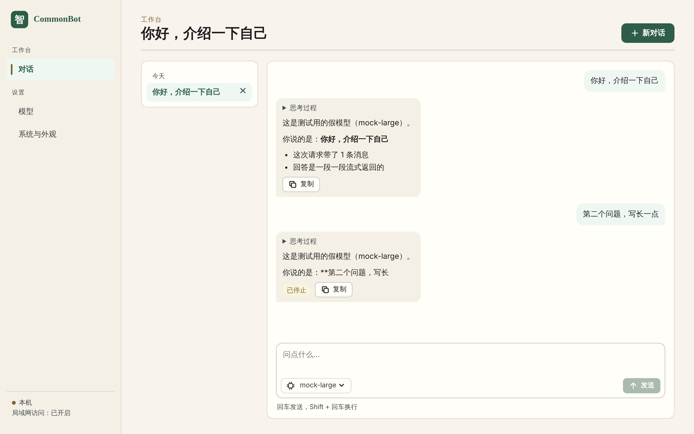
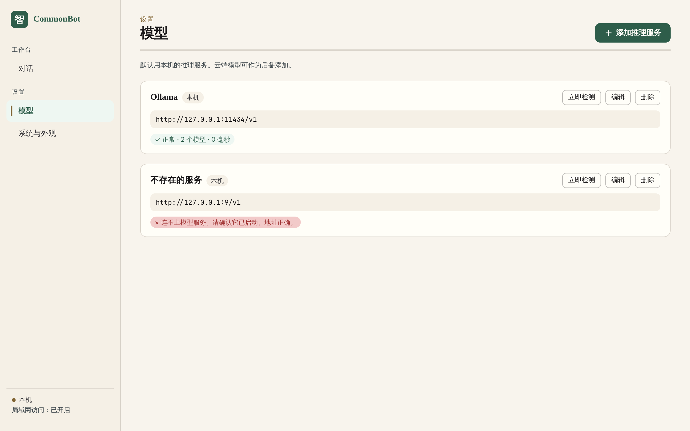
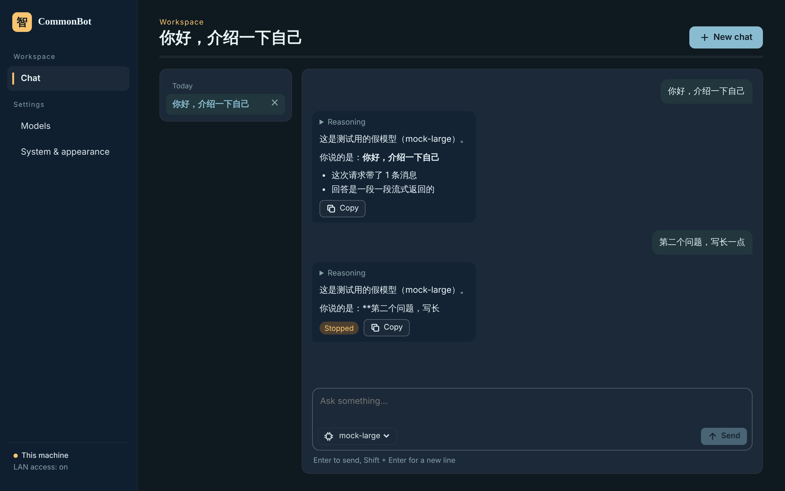
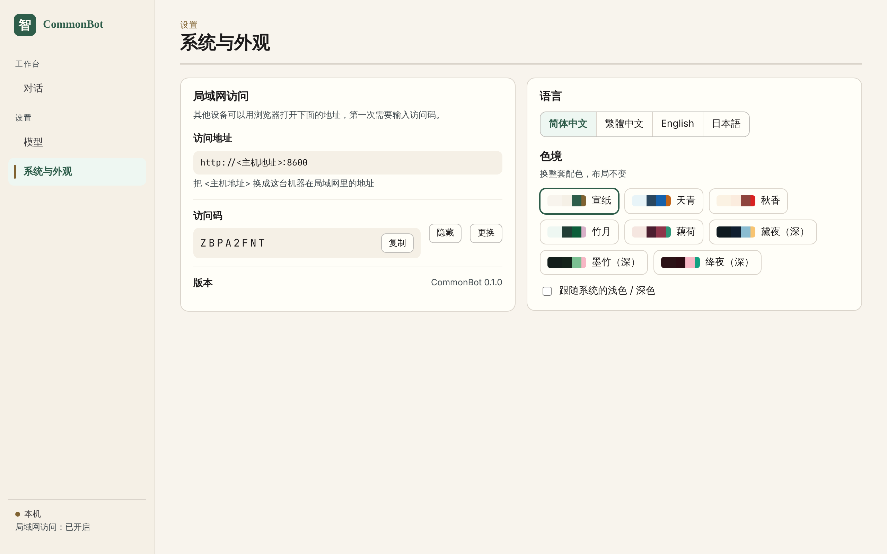
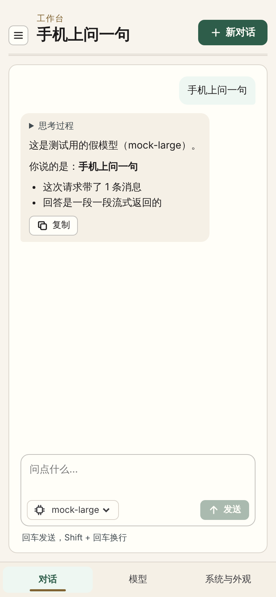

# CommonBot

通用智能体平台：新建智能体并定义职责、为智能体建知识库（可结合联网回答）、通过对话生成新的智能体。主机为 NVIDIA DGX Spark，Rust 实现。

当前阶段：**P0 骨架已完成**——服务能启动，浏览器里可以和模型流式对话；智能体、知识库、建造师在后续阶段。

- 方案：[docs/v1/PLAN.md](docs/v1/PLAN.md)
- 决策：[docs/v1/DECISIONS.md](docs/v1/DECISIONS.md)
- 进度：[docs/v1/PROGRESS.md](docs/v1/PROGRESS.md)
- 效果图（演示数据，浏览器直接打开）：[docs/v1/mockup/index.html](docs/v1/mockup/index.html)

## 现在能做什么

- 连接本机的推理服务（默认 Ollama，也可以是 vLLM、llama.cpp 等任何 OpenAI 兼容接口），检测连通并列出模型
- 流式对话，可中途停止，已生成的部分会保留；对话保存在本机，重启后还在
- 添加云端模型作为后备；密钥只存在本机，不会回传给界面
- 简体中文、繁體中文、English、日本語；八套色境
- 默认只有本机能用；开放局域网后，其他设备凭访问码进入

## 从源码运行（Spark 与 Mac 相同）

需要 Rust、Node 22 和 pnpm，以及一个已装好模型的推理服务（例如 Ollama）。

```bash
pnpm --dir web install --frozen-lockfile
```

```bash
pnpm --dir web build
```

```bash
cargo build --release -p commonbot-server
```

只在本机使用：

```bash
./target/release/commonbot
```

让局域网里的其他设备也能用（启动时会打印访问码）：

```bash
./target/release/commonbot --listen 0.0.0.0:8600
```

然后打开 <http://localhost:8600>。数据默认放在系统的应用数据目录，可用 `--data-dir` 指定。

没有模型服务时，可以用仓库里的假模型看界面（它只会复述你的话）：

```bash
cargo run -p commonbot-mock-llm
```

## 检查

```bash
pnpm --dir web test
```

```bash
cargo test --workspace
```

## 实际界面截图（P0）

| 对话（宣纸） | 模型设置 |
| --- | --- |
|  |  |

| 深色 + 英文 | 系统与外观 | 手机 |
| --- | --- | --- |
|  |  |  |

## 效果图截图

| 智能体对话（宣纸） | 知识库文件夹 |
| --- | --- |
|  |  |

| 提问时选知识范围 | 配置抽屉 |
| --- | --- |
|  |  |

| 建造师 | 深色（黛夜·青灯） | 手机端 |
| --- | --- | --- |
|  |  |  |

M&J Group · 473276@qq.com
