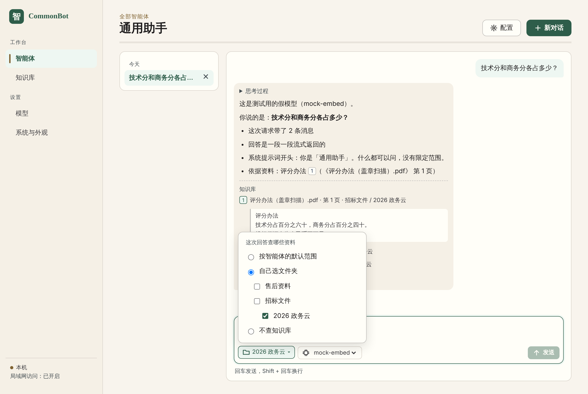
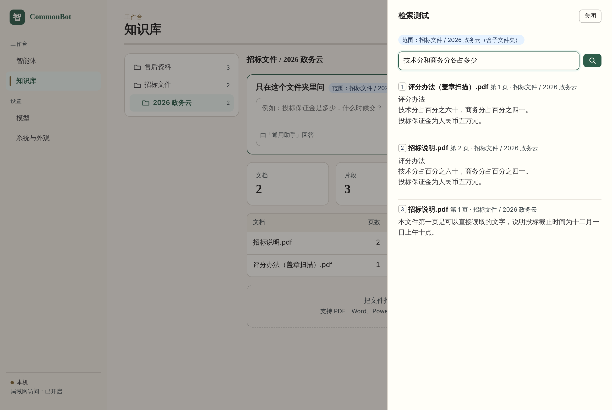
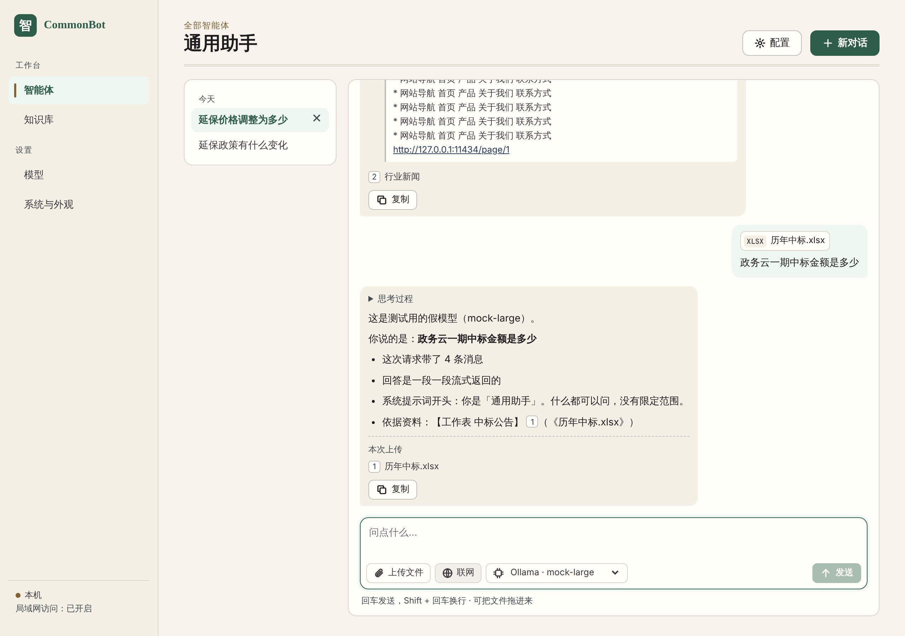
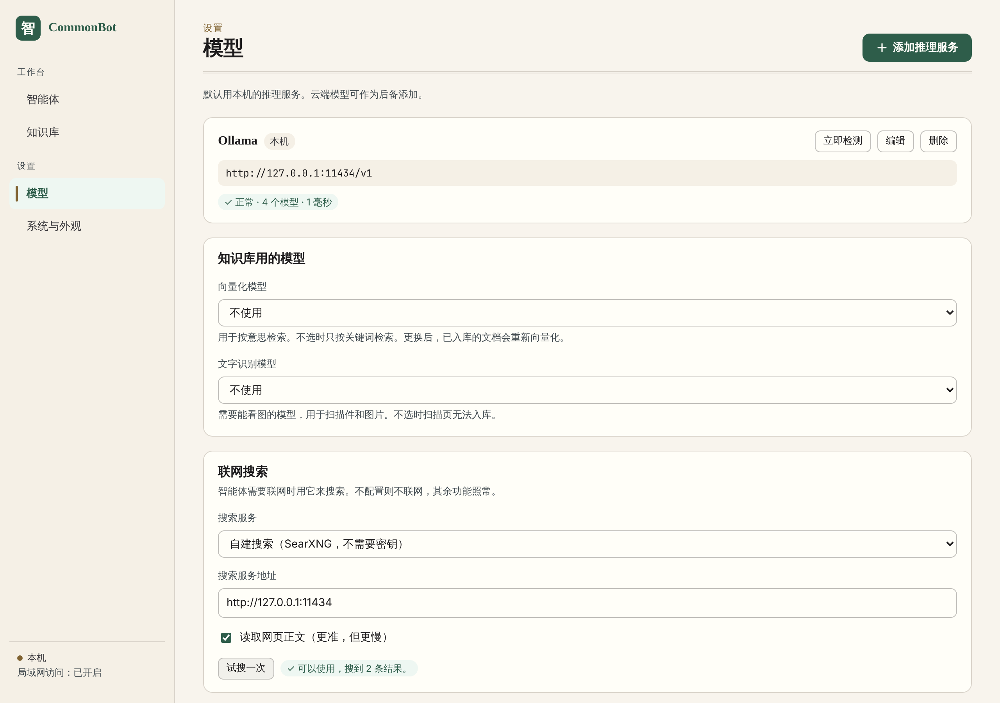
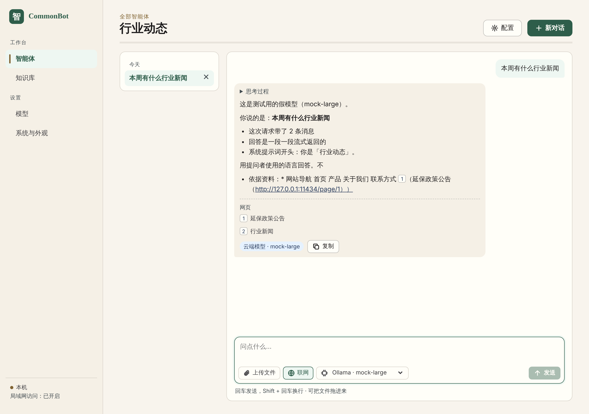
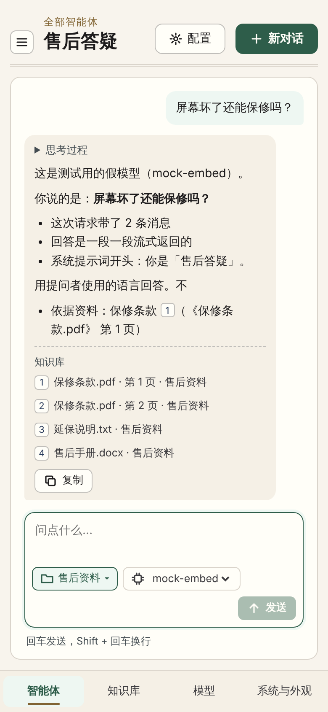
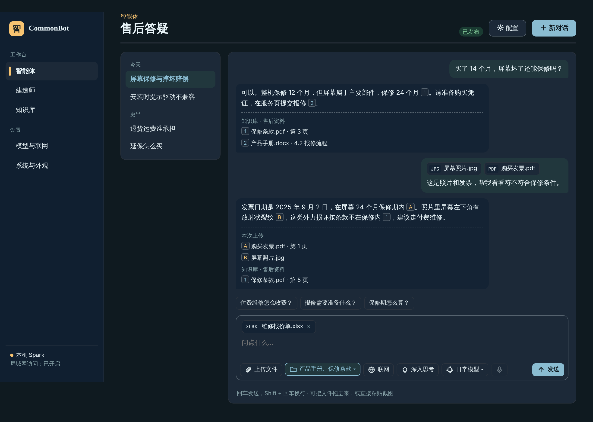

# CommonBot

通用智能体平台：新建智能体并定义职责、为智能体建知识库（可结合联网回答）、通过对话生成新的智能体。主机为 NVIDIA DGX Spark，Rust 实现。

当前阶段：**P3 联网已完成**——智能体可以依据知识库、联网结果和对话里上传的文件回答；建造师、客户端和安装包在后续阶段。

- 方案：[docs/v1/PLAN.md](docs/v1/PLAN.md)
- 决策：[docs/v1/DECISIONS.md](docs/v1/DECISIONS.md)
- 进度：[docs/v1/PROGRESS.md](docs/v1/PROGRESS.md)
- 效果图（演示数据，浏览器直接打开）：[docs/v1/mockup/index.html](docs/v1/mockup/index.html)

## 现在能做什么

- 新建智能体：写清负责什么、不负责什么、开场白和示例问题，可固定使用某个模型；系统提示词由这些内容生成并可预览
- 每个智能体有自己的对话记录
- 知识库：多级文件夹；上传 PDF、Word、PowerPoint、Excel、文本、Markdown、网页、图片；扫描件由看图模型识别；入库在后台排队，可暂停、重试
- 依据知识库回答：关键词和语义两路检索，回答里标注出处编号，点开可看原文片段
- 联网：自建搜索（SearXNG）或搜索接口；每个智能体可设「不联网 / 知识库优先、不足时联网 / 每次都联网」，对话里可临时开关；可进一步读取网页正文；网页内容只当资料，不当指令
- 对话里上传文件：只在这个对话里使用，不进知识库；出处按「知识库 / 本次上传 / 网页」分开标注
- 云端后备：本机模型连不上时，允许的智能体改用云端模型，并在回答上标明
- 知识范围可以选到文件夹：智能体有默认范围，每次对话可临时改，也可以在文件夹页面直接提问
- 连接本机的推理服务（默认 Ollama，也可以是 vLLM、llama.cpp 等任何 OpenAI 兼容接口），检测连通并列出模型
- 流式对话，可中途停止，已生成的部分会保留；对话保存在本机，重启后还在
- 添加云端模型作为后备；密钥只存在本机，不会回传给界面
- 简体中文、繁體中文、English、日本語；八套色境
- 默认只有本机能用；开放局域网后，其他设备凭访问码进入

## 从源码运行（Spark 与 Mac 相同）

需要 Rust、Node 22 和 pnpm，以及一个已装好模型的推理服务（例如 Ollama）。

先取 PDF 解析库（只需一次）：

```bash
scripts/fetch-vendor.sh
```

```bash
pnpm --dir web install --frozen-lockfile
```

```bash
pnpm --dir web build
```

```bash
cargo build --release -p commonbot-server
```

只在本机使用：

```bash
./target/release/commonbot
```

让局域网里的其他设备也能用（启动时会打印访问码）：

```bash
./target/release/commonbot --listen 0.0.0.0:8600
```

然后打开 <http://localhost:8600>。数据默认放在系统的应用数据目录，可用 `--data-dir` 指定。

没有模型服务时，可以用仓库里的假模型看界面（它只会复述你的话）：

```bash
cargo run -p commonbot-mock-llm
```

## 检查

```bash
pnpm --dir web test
```

```bash
cargo test --workspace
```

## 实际界面截图

| 智能体对话：依据知识库回答，带出处 | 知识库：文件夹、文档、入库状态 |
| --- | --- |
|  |  |

| 提问时选知识范围 | 检索测试 |
| --- | --- |
|  |  |

| 联网回答 | 对话里上传文件 |
| --- | --- |
|  |  |

| 联网搜索设置 | 云端后备 |
| --- | --- |
|  |  |

| 智能体列表 | 配置抽屉 | 手机 |
| --- | --- | --- |
|  |  |  |

## 效果图截图

| 智能体对话（宣纸） | 知识库文件夹 |
| --- | --- |
|  |  |

| 提问时选知识范围 | 配置抽屉 |
| --- | --- |
|  |  |

| 建造师 | 深色（黛夜·青灯） | 手机端 |
| --- | --- | --- |
|  |  |  |

M&J Group · 473276@qq.com
