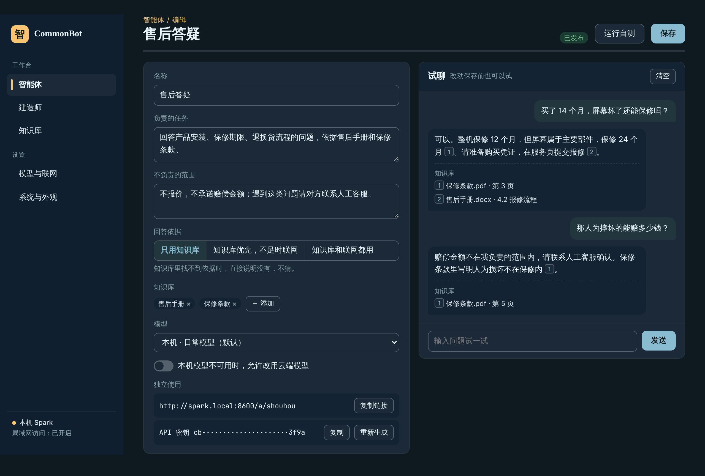
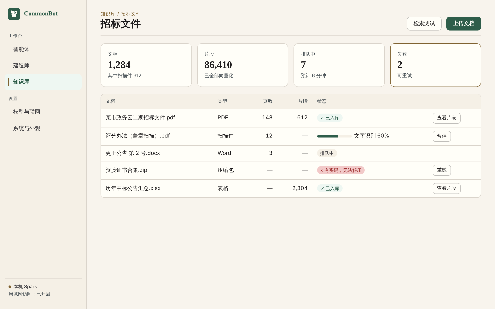
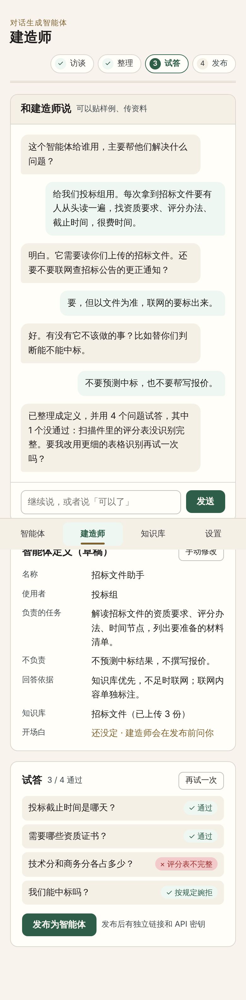

# CommonBot

通用智能体平台：新建智能体并定义职责、为智能体建知识库（可结合联网回答）、通过对话生成新的智能体。主机为 NVIDIA DGX Spark，Rust 实现。

当前阶段：选型与形态已定，界面效果图待确认，尚未开始写功能代码。

- 方案：[docs/v1/PLAN.md](docs/v1/PLAN.md)
- 决策：[docs/v1/DECISIONS.md](docs/v1/DECISIONS.md)
- 进度：[docs/v1/PROGRESS.md](docs/v1/PROGRESS.md)
- 效果图（演示数据，浏览器直接打开）：[docs/v1/mockup/index.html](docs/v1/mockup/index.html)

## 效果图截图

| 建造师（宣纸） | 智能体编辑与试聊（黛夜·青灯） |
| --- | --- |
|  |  |

| 知识库 | 手机端 |
| --- | --- |
|  |  |

M&J Group · 473276@qq.com
